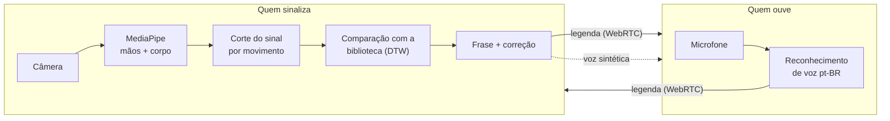

<div align="center">

# 🤟 Mãos que Falam

**Reunião por vídeo onde a Libras vira legenda e voz, e a fala vira legenda.**

Uma pessoa surda sinaliza e quem ouve recebe o texto e a voz.
Quem ouve fala e a pessoa surda lê na tela.

[**▶ Abrir o site**](https://thisilva49.github.io/maos-que-falam/) · [Como usar](#-como-usar) · [Como funciona](#-como-funciona) · [Limitações](#-limitações)

</div>

---

## ✨ O que ele faz

| | |
|---|---|
| 🎥 **Reunião por link** | Crie uma sala e mande o convite. Funciona no navegador, sem instalar nada e sem cadastro. |
| 🤟 **Libras → texto e voz** | A câmera lê as mãos e o corpo, reconhece o sinal e mostra a frase como **legenda para todos**. Para quem ouve, a frase também é **falada em voz alta**. |
| 🗣️ **Voz → texto** | O que cada pessoa fala vira **legenda em tempo real** no vídeo dela. |
| ✏️ **Correção com um clique** | Quem sinaliza vê cada palavra reconhecida e pode trocar, remover ou digitar a certa antes de enviar. **Toda correção ensina o programa.** |
| 💬 **Conversa registrada** | Transcrição de tudo (sinais, falas e chat) no painel lateral, com nome e horário. |
| 📚 **Biblioteca pronta** | Milhares de vídeos de dicionários de Libras. Não é preciso ensinar os sinais antes. |

## 🚀 Como usar

Abra **[thisilva49.github.io/maos-que-falam](https://thisilva49.github.io/maos-que-falam/)** no **Chrome** ou no **Edge**. Escreva seu nome, escolha como vai participar e clique em **Criar reunião**. Depois use **🔗 Copiar convite** e mande o link para os outros.

### Se você usa Libras 🤟

1. Fique de frente para a câmera, com **ombros e peito aparecendo**.
2. Espere o aviso **🟢 Pronto para sinalizar** no canto do vídeo.
3. Faça o sinal e depois **pare um instante ou abaixe as mãos**. O aviso fica 🔴 enquanto ele lê.
4. A palavra aparece em **Minha frase em Libras** e na sua legenda.
   - Se ele errou, clique numa das sugestões ou digite a palavra certa.
5. Depois de **3 segundos parado**, a frase é enviada para todos e falada em voz alta. Se preferir, clique em **Enviar**.

> 💡 **Dica:** o vocabulário padrão tem cerca de 300 **palavras do dia a dia**, porque assim ele acerta mais.
> Para usar todas as palavras da biblioteca, vá em *Ajustes*.
> Palavras que faltam, ou que ele erra muito, podem ser gravadas em **Ensinar um sinal**.

### Se você fala 🗣️

1. Deixe **💬 Legendar fala** ligado (ele já vem ligado).
2. Fale normalmente. Quem é surdo lê a sua fala como legenda no seu vídeo e na conversa.
3. O que for sinalizado em Libras é **lido em voz alta** para você. Dá para desligar em *Ajustes*.

> 🎧 Use **fone de ouvido**. Assim a legenda não transcreve a voz dos outros que sai da sua caixa de som.

## 🧠 Como funciona



- **Leitura dos sinais:** o [MediaPipe](https://ai.google.dev/edge/mediapipe) encontra 21 pontos de cada mão e os pontos do corpo. A posição das mãos é medida **em relação aos ombros**, então a distância da câmera não importa.
- **Corte automático:** o sinal começa quando a mão levantada começa a se mexer. Ele termina quando a mão para ou abaixa. Movimentos curtos demais, sem os dedos visíveis ou que empatam entre várias palavras são **ignorados**, para não traduzir o que não é Libras.
- **Reconhecimento:** o sinal é comparado com os da biblioteca por *Dynamic Time Warping*, que tolera sinais feitos mais rápido ou mais devagar. Ele também compara a versão espelhada, então funciona para destros e canhotos.
- **Aprendizado:** cada correção guarda o seu jeito de fazer o sinal, que passa a pesar mais que os vídeos dos dicionários.
- **Reunião:** o vídeo, o áudio e as legendas vão direto de um navegador para o outro, por WebRTC com [PeerJS](https://peerjs.com/).

### 🔒 Privacidade

O reconhecimento de Libras roda **no seu próprio navegador**: as imagens da câmera não são enviadas a nenhum servidor deste projeto. Os sinais ensinados ficam guardados só no seu navegador. Há três exceções:
- o **reconhecimento de voz** usa o serviço do próprio Chrome/Edge;
- o PeerJS usa um servidor público só para apresentar os participantes;
- a chamada de vídeo é direta entre os participantes.

## 📊 Limitações

Dizemos com franqueza o que ele faz bem e o que ainda não faz:

- **Precisão:** no vocabulário essencial, testando cada vídeo contra vídeos de **outras pessoas e outros dicionários**, ele acerta de primeira **≈36%** das vezes. A palavra certa aparece entre as **5 sugestões** em **≈49%** das vezes. Com as correções e os sinais ensinados por você, ele melhora para o seu jeito de sinalizar.
- **Variação regional:** muitos sinais mudam de região para região. Se o seu não estiver na biblioteca, ensine com **Ensinar um sinal**.
- **Sem expressão facial e sem gramática:** ele reconhece **palavras isoladas** e monta a frase na ordem em que foram sinalizadas.
- **Navegador:** a legenda de voz só funciona no **Chrome** e no **Edge**.
- **Tamanho da reunião:** pensado para reuniões pequenas, com até cerca de 5 pessoas. Se quem criou a sala sair, a sala é reaberta para quem entrar depois.
- **Computador:** com menos de ~6 imagens por segundo o reconhecimento piora. A velocidade aparece no rodapé da página.

## 🛠️ Rodar no seu computador

Precisa de [Node.js](https://nodejs.org/).

```bash
node servidor.js
# abra http://localhost:8090
```

No Windows, também dá para dar dois cliques em `iniciar.bat`.

### Estrutura

```
index.html        página (entrada e sala de reunião)
app.js            reunião: conexões, legendas, voz, frase e correções
libras.js         motor de reconhecimento de Libras (MediaPipe + corte + comparação)
estilo.css        visual (tema claro e escuro)
biblioteca.bin    pontos dos sinais da biblioteca (int8)
biblioteca.json   palavras, rótulos e parâmetros da biblioteca
servidor.js       servidor local mínimo
preparo/          scripts que geram a biblioteca a partir dos vídeos
```

### Gerar a biblioteca de sinais

Precisa de [uv](https://docs.astral.sh/uv/). O download é grande (dezenas de GB) e leva algumas horas. Ele pode ser interrompido e retomado.

```bash
cd preparo
uv run python -I listar.py          # vídeos da tabela do MALTA-LIBRAS
uv run python -I listar_extras.py   # vídeos fora da tabela (palavra vem do nome do arquivo)
uv run python -I extrair.py 5       # baixa e extrai os pontos (5 processos, prioridade baixa)
uv run python -I construir.py --avaliar
```

O vocabulário essencial fica em [`preparo/essenciais.txt`](preparo/essenciais.txt), uma palavra por linha.

> As contas de características em `libras.js` e `preparo/construir.py` precisam ser **idênticas**.
> O script `preparo/paridade_dump.py` gera casos para conferir isso.

## 🙏 Créditos

- **Sinais:** [MALTA-LIBRAS](https://huggingface.co/datasets/MALTA-Lab/MALTA_LIBRAS), do [Malta Lab](https://github.com/Malta-Lab/ISLR_LIBRAS) (licença MIT). A base reúne vídeos do **INES**, da **UFSC** (Corpus Libras e SignBank), do **Spread the Sign**, da **USP**, da **UFV** e do YouTube. Este projeto guarda **só os pontos** extraídos, não os vídeos.
- **Visão computacional:** [MediaPipe](https://ai.google.dev/edge/mediapipe), do Google.
- **Conexão:** [PeerJS](https://peerjs.com/).

---

<div align="center">
Feito para aproximar quem sinaliza de quem fala. 🤟🗣️
</div>
